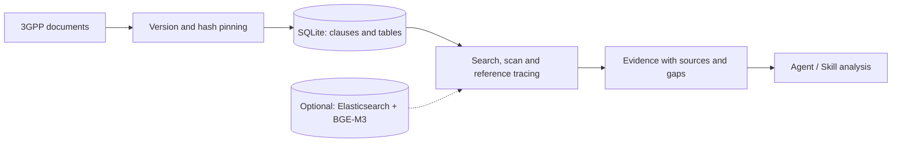

# 3GPP Spec Retriever

## Introduction

A tool for agents and skills to retrieve traceable evidence from 3GPP specifications.

- Search documents, read complete clauses and tables, and follow references across specifications.
- Pin each corpus baseline to exact versions and SHA-256 hashes.
- Check official versions within the same Release, identify missing documents, and rebuild indexes and embeddings when updating.

SQLite provides local full-text retrieval. Elasticsearch and BGE-M3 add optional hybrid search and ColBERT reranking. Results include source locations, version information, and unresolved gaps; the consuming agent performs compliance analysis.



## Usage

### 1. Install

Requires Python 3.11+. Run commands from the repository root using your virtual environment.

```powershell
python -m venv .venv
.\.venv\Scripts\Activate.ps1
python -m pip install -e ".[mcp]"
```

On Linux/macOS, activate with `source .venv/bin/activate` instead.

### 2. Index documents

Download and extract an official DOCX. For example, save the document from the
[TS 29.531 V17.12.0 archive](https://www.3gpp.org/ftp/specs/archive/29_series/29.531/29531-hc0.zip)
as `data/29531-hc0.docx`. Create `data/manifest.json`:

```json
{
  "schema_version": 1,
  "baseline": "r17",
  "release": 17,
  "documents": [
    {
      "spec": "29.531",
      "version": "17.12.0",
      "path": "29531-hc0.docx",
      "source_url": "https://www.3gpp.org/ftp/specs/archive/29_series/29.531/29531-hc0.zip"
    }
  ]
}
```

Document paths are relative to the manifest. This example pins a specific version; use the checks below to verify freshness.

```powershell
python -m spec_retriever lock data/manifest.json --output data/baseline.lock.json
python -m spec_retriever ingest data/baseline.lock.json --db data/corpus.sqlite3
```

### 3. Retrieve evidence

```powershell
# Check corpus availability and parsing warnings.
python -m spec_retriever status --db data/corpus.sqlite3 --baseline r17

# Search, then read a complete clause.
python -m spec_retriever search "NssaiAvailabilityInfo" --db data/corpus.sqlite3 --baseline r17
python -m spec_retriever clause --db data/corpus.sqlite3 --baseline r17 --spec 29.531 --version 17.12.0 --clause 6.2.6.2.2

# Collect related clauses and follow references, or scan all supported source blocks.
python -m spec_retriever collect "NSSAI availability authorization" --db data/corpus.sqlite3 --baseline r17
python -m spec_retriever scan --db data/corpus.sqlite3 --baseline r17 --term NSSAIAvailability
```

Search and reference expansion have limits. Inspect reported gaps and pagination before drawing conclusions; the tool does not guarantee that every applicable requirement has been found.

### 4. Connect an agent

Configure your MCP client with the virtual environment's absolute Python path and your database path:

```json
{
  "mcpServers": {
    "3gpp-spec-retriever": {
      "command": "/absolute/path/to/.venv/bin/python",
      "args": ["-m", "spec_retriever", "serve", "--db", "/absolute/path/to/data/corpus.sqlite3"]
    }
  }
}
```

On Windows, use the absolute path to `.venv/Scripts/python.exe`.

The server exposes seven read-only tools: `search_specs`, `get_clause`, `get_corpus_status`, `list_clauses`, `expand_references`, `collect_evidence`, and `scan_corpus`. Pass the baseline name, such as `r17`, when querying.

See the [agent skill](skills/3gpp-spec-retriever/SKILL.md) for the evidence collection workflow.

### 5. Check and update documents

Official archive access requires Node.js 18+. Check versions, local files, index status, and missing references:

```powershell
python -m spec_retriever check-documents data/baseline.lock.json --db data/corpus.sqlite3
```

To download updates and rebuild embeddings, install the optional backend and start Elasticsearch 8.x first. Set `ELASTICSEARCH_URL` if it is not at `http://localhost:9200`.

```powershell
python -m pip install -e ".[elastic]"
python -m spec_retriever sync-documents data/baseline.lock.json --db data/corpus.sqlite3 --directory data/managed
```

Add `--lexical-only` to update SQLite without embeddings or Elasticsearch. Updates publish a new baseline only after the selected build steps succeed and preserve the previous generation on failure. Query the active version with:

```powershell
python -m spec_retriever search "NssaiAvailabilityInfo" --db data/corpus.sqlite3 --baseline "@data/managed/current.json"
```

Use `--required-spec` for expected documents, `--include-references` to select undated or same-Release references, and `--series` to compare an official series. Explicit version references remain pinned.

### 6. Repair a failed DOCX import

When `ingest` reports `parse_failed`, the optional repair agent can reproduce the error in an isolated Git worktree, patch the parser, re-import the complete locked manifest, and request an independent read-only review. It opens a PR only after all checks pass. Install and authenticate the Codex and GitHub CLIs first:

```powershell
python -m spec_retriever heal-import data/baseline.lock.json --db data/corpus.sqlite3
```

Use `--no-pr` to exercise the repair and validation without pushing a branch. A report and worktree remain under the ignored `evaluation/self-heal/` directory. The agent repairs code-level import failures; use `sync-documents` for missing, damaged, or outdated source files. It never modifies the official DOCX or merges its own PR.
